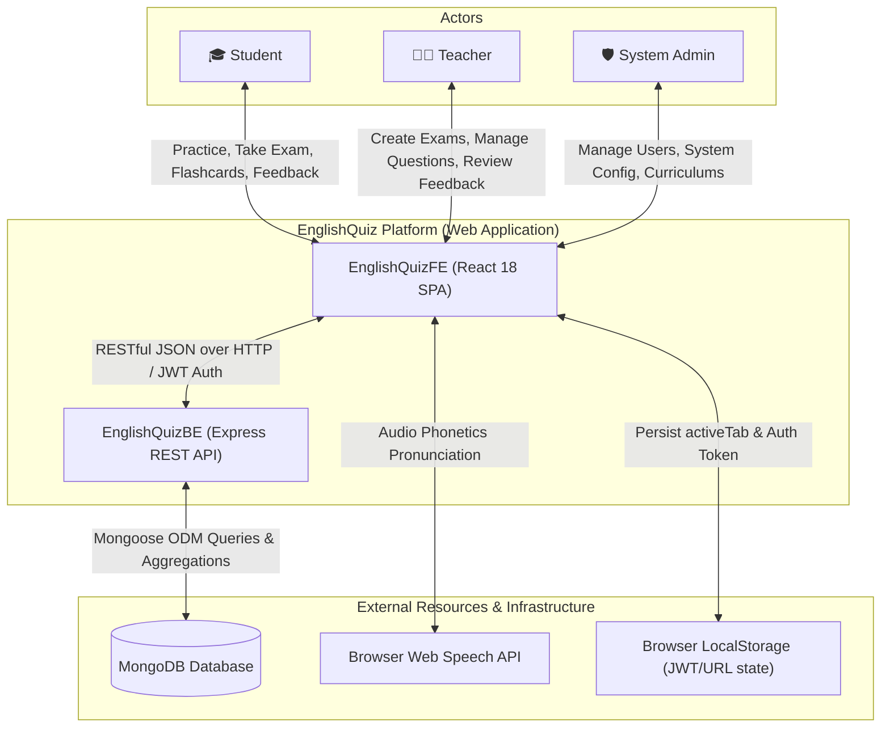
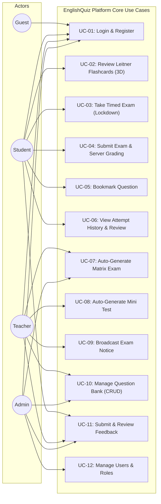
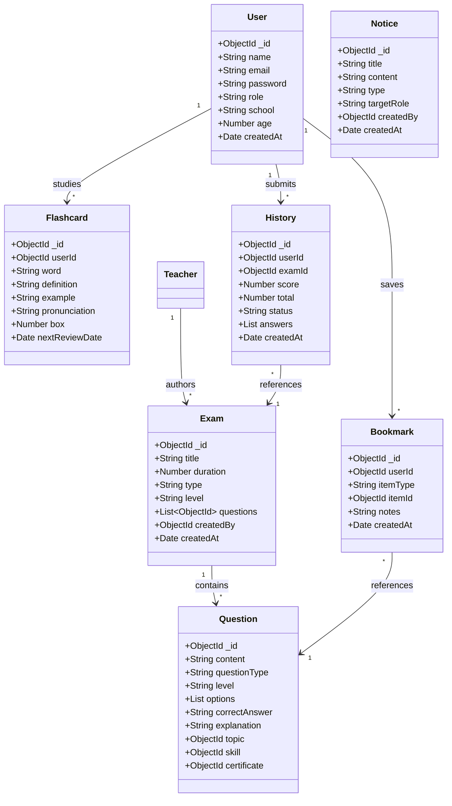
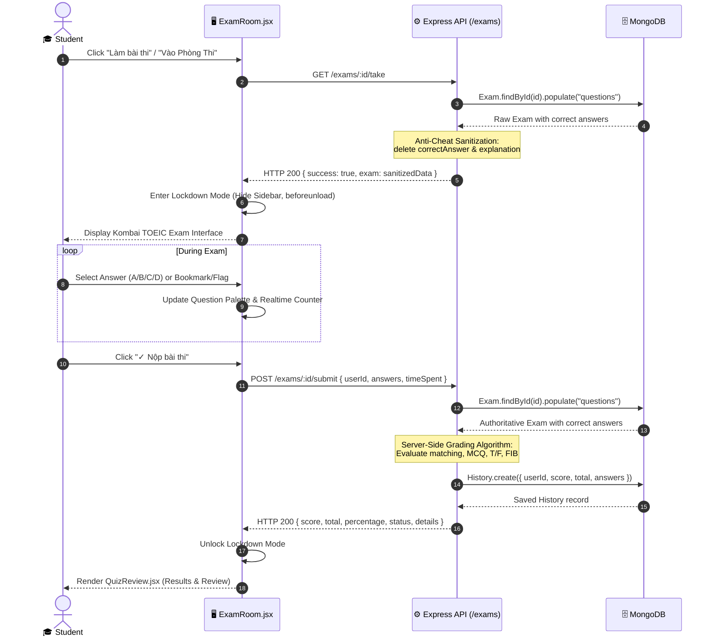
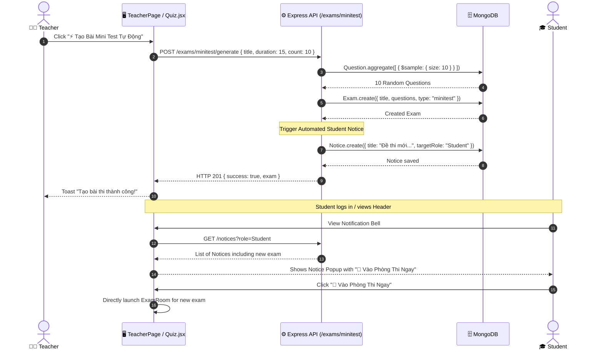
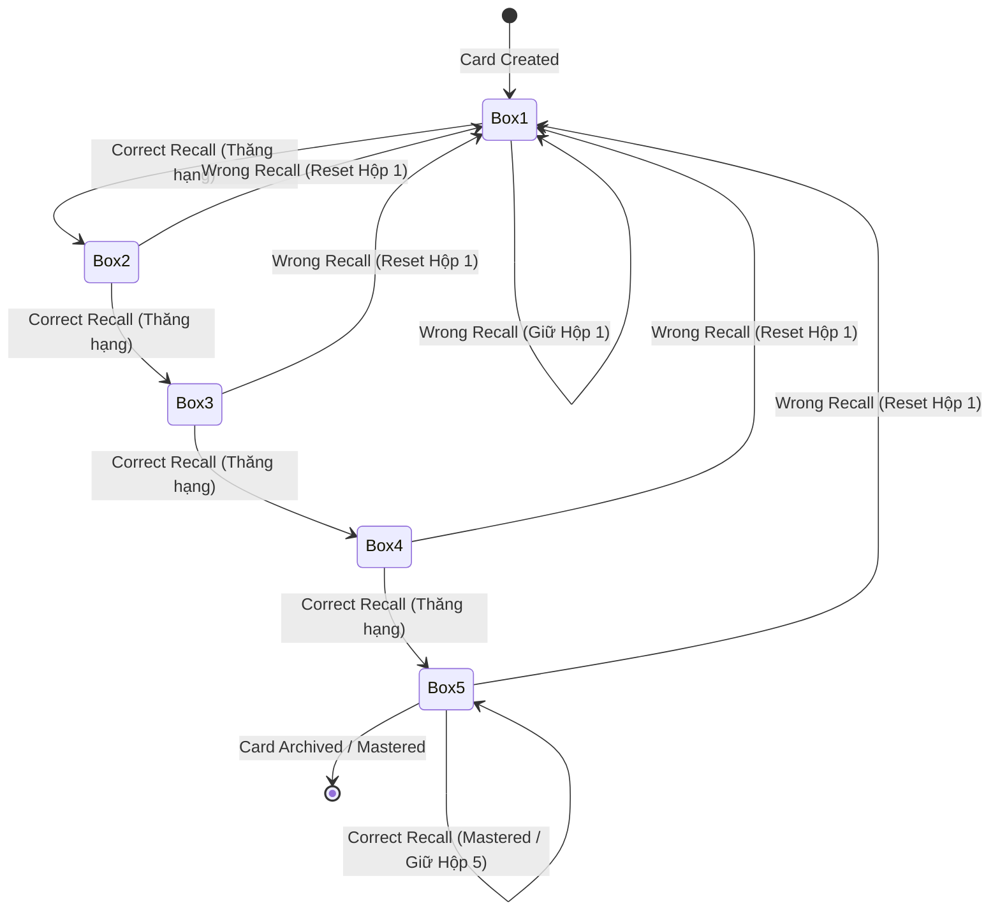
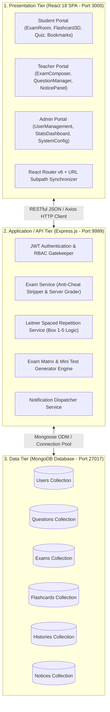
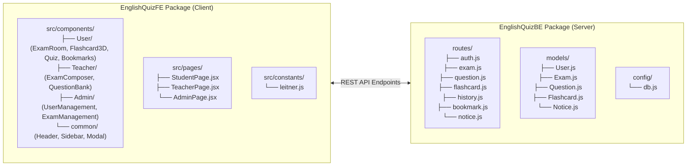
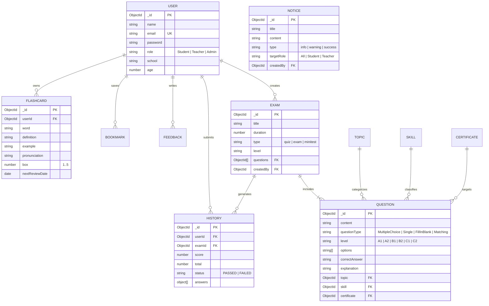

# COURSE PROJECT REPORT
## Subject: SDN302 — Web Application Development (NodeJS & ReactJS)
### Semester: Fall 2026 — FPT University

---

# PROJECT: ENGLISHQUIZ PLATFORM
## Intelligent English Assessment, Automated Matrix Exam & Leitner Spaced Repetition Learning System

**Project Code:** `SDN302_FA26_EQP`  
**Group Identifier:** Group 5 (SDN302)  
**Project Members:** Lê Duy (Leader), Nguyễn Tuấn Minh  
**Software Type:** Full-Stack Web Application (MERN: MongoDB, Express, React, Node.js)  
**Date:** September – November 2026  

---

## Record of Changes

| Date | Ver | Author | In Charge | Change Description |
| :--- | :---: | :--- | :--- | :--- |
| **2026-10-31** | 1.0 | Dev Team | Architecture & Core | Initial project setup, database schema design, and basic CRUD APIs |
| **2026-11-05** | 1.5 | Dev Team | Anti-Cheat & Exam | Implementation of server-side grading and anti-cheat answer stripping |
| **2026-11-08** | 2.0 | Dev Team | Leitner & 3D UI | Integration of Leitner 5-Box spaced repetition and 3D flip card component |
| **2026-11-09** | 2.5 | Dev Team | Kombai UI & Notice | Adoption of Kombai TOEIC Reading Mini Test layout and exam notification triggers |
| **2026-11-10** | 3.0 | Dev Team | Final & QA | Dual-pass QA verification (56/56 tests passing), exam lockdown mode, F5 URL sync |

---

# Table of Contents
- [I. Overview](#i-overview)
  - [I.1 Project Information](#i1-project-information)
  - [I.2 Project Team](#i2-project-team)
- [II. Requirement Specification](#ii-requirement-specification)
  - [II.1 Background & Problem Description](#ii1-background--problem-description)
  - [II.2 Market & Competitor Analysis](#ii2-market--competitor-analysis)
  - [II.3 Business Opportunity, Objectives & Success Metrics](#ii3-business-opportunity-objectives--success-metrics)
  - [II.4 Vision Statement & Risk Management](#ii4-vision-statement--risk-management)
  - [II.5 Major Features](#ii5-major-features)
  - [II.6 System Context Diagram](#ii6-system-context-diagram)
  - [II.7 Non-Functional Requirements (Planguage / ISO 25010)](#ii7-non-functional-requirements-planguage--iso-25010)
  - [II.8 Functional Requirements & Use Cases](#ii8-functional-requirements--use-cases)
- [III. Analysis Models](#iii-analysis-models)
  - [III.1 Domain Class Diagram](#iii1-domain-class-diagram)
  - [III.2 Interaction (Sequence) Diagrams](#iii2-interaction-sequence-diagrams)
  - [III.3 State Machine Diagrams](#iii3-state-machine-diagrams)
- [IV. Design Specification](#iv-design-specification)
  - [IV.1 System High-Level Architecture (3-Tier)](#iv1-system-high-level-architecture-3-tier)
  - [IV.2 Component & Package Diagrams](#iv2-component--package-diagrams)
  - [IV.3 Detailed Class & Module Diagram](#iv3-detailed-class--module-diagram)
  - [IV.4 Database Design (ERD & Data Dictionary)](#iv4-database-design-erd--data-dictionary)
- [V. Implementation Mapping](#v-implementation-mapping)
  - [V.1 Architecture to Project Directory Mapping](#v1-architecture-to-project-directory-mapping)
  - [V.2 Design Elements to Code Mapping](#v2-design-elements-to-code-mapping)
- [VI. Alternative Architecture Patterns](#vi-alternative-architecture-patterns)
  - [VI.1 Monolith vs Service-Oriented Architecture (SOA / Microservices)](#vi1-monolith-vs-service-oriented-architecture-soa--microservices)
  - [VI.2 Spaced Repetition Engine & Exam Lockdown Security Patterns](#vi2-spaced-repetition-engine--exam-lockdown-security-patterns)

---

# I. Overview

## I.1 Project Information
- **Project Name:** EnglishQuiz Platform — Intelligent English Assessment & Spaced Repetition System
- **Project Code:** `SDN302_FA26_EQP`
- **Course:** SDN302 (Web Application Development with NodeJS, ExpressJS and ReactJS)
- **Target Audience:** Vietnamese college students preparing for TOEIC/IELTS certificates, English language lecturers, and academic training centers.
- **Technology Stack:**
  - **Frontend:** React 18, React Router v6, Tailwind CSS, Lucide Icons, Web Speech API (Native Speech Synthesis).
  - **Backend:** Node.js v20+, Express.js RESTful API, JSON Web Token (JWT), bcryptjs.
  - **Database:** MongoDB 7.0 with Mongoose ODM.
  - **Testing & Tooling:** Dual-pass E2E Integration Suite, React Scripts Build, Kombai UI Engine.

## I.2 Project Team
| Full Name | Role | Responsibilities | Email |
| :--- | :---: | :--- | :--- |
| **Lê Duy** | Project Leader & Full-Stack Architect | System architecture, exam engine, Leitner repetition algorithm, test automation | `leduy0426@gmail.com` |
| **Nguyễn Tuấn Minh** | Full-Stack Developer & QA Engineer | Frontend UI components, Backend REST APIs, database schemas, quality assurance | `tuanminh@gmail.com` |

---

# II. Requirement Specification

## II.1 Background & Problem Description
English proficiency (specifically standardized certifications like TOEIC, IELTS, and CEFR) is a mandatory graduation requirement across Vietnamese universities. However, learners and educators face critical systemic friction:
1. **The Forgetting Curve in Vocabulary Acquisition:** Traditional learning platforms treat vocabulary memorization statically. Without scheduled intervals, learners lose over 75% of new vocabulary within 48 hours (Ebbinghaus curve).
2. **Client-Side Vulnerabilities & Exam Cheating:** Web-based quiz platforms commonly embed correct answers, explanations, or scoring weights within client-side JavaScript payloads. Students can effortlessly open Developer Tools (F12) to inspect network responses or DOM nodes, invalidating test scores.
3. **Rigid Test Generation:** Teachers spend excessive manual effort curating balanced tests across difficulty tiers (Easy, Medium, Hard). Without matrix algorithms, tests skew disproportionately easy or difficult.
4. **Disjointed Practice vs. Assessment:** Existing tools isolate flashcard tools (e.g., Quizlet) from formal examination rooms, preventing students from bookmaking missed exam questions directly into a spaced repetition schedule.

The **EnglishQuiz Platform** resolves these challenges by uniting **Leitner 5-Box Spaced Repetition**, an **Authoritative Server-Side Anti-Cheat Exam Room**, and **Automated Matrix & Mini Test Generation** into a single cohesive web application.

## II.2 Market & Competitor Analysis

| Evaluation Dimension | EnglishQuiz Platform | Quizlet | Prep.vn / TOEIC Test Pro | Test-English |
| :--- | :--- | :--- | :--- | :--- |
| **Spaced Repetition** | **Leitner 5-Box Algorithm** with 3D flip cards, IPA, and Web Speech API audio | Basic flashcards (Spaced Repetition locked behind subscription) | Absent (Only static word lists) | Absent |
| **Exam Anti-Cheat** | **Zero Client Leaks**: Answers stripped on server; server calculates score; exam lockdown mode | None (Client-side self-check) | Basic timer, but answers often observable in Network tab | Client-side javascript grading |
| **Exam Composition** | **Dynamic Matrix & Mini Test Generator** (Easy/Med/Hard distribution) | Manual deck creation only | Fixed pre-composed practice tests | Fixed grammar exercises |
| **Role-Based Experience** | Dedicated portals for **Student, Teacher, and Admin** | Generic user accounts | Student-centric portal | Anonymous / Public |
| **Cost & Openness** | **Free & Open Source** for University education | Freemium (Heavy paywall for ads and Leitner) | High subscription fee per test package | Free with ads |

## II.3 Business Opportunity, Objectives & Success Metrics

### Business Objectives (BO)
- **BO-1 (Learning Retention):** Increase long-term retention of academic and TOEIC vocabulary by at least 65% through systematic 5-box spaced repetition.
- **BO-2 (Academic Integrity):** Achieve 100% prevention of client-side answer sniffing and score tampering in timed examinations.
- **BO-3 (Teacher Productivity):** Reduce test creation time from 45 minutes to under 5 seconds via Automated Matrix and Quick Mini Test generators.
- **BO-4 (Continuous Engagement):** Maintain student review consistency with instant notice delivery and direct exam jump links (`🚀 Vào Phòng Thi Ngay`).

### Measurable Success Metrics (SM)
- **SM-1:** 100% of exam question payloads delivered through `GET /exams/:id/take` have `correctAnswer` and `explanation` stripped.
- **SM-2:** 100% of test submissions calculate scores authoritatively on the backend (`POST /exams/:id/submit`).
- **SM-3:** 0% failure in URL preservation during browser refresh (F5) across all 3 roles and 21 sub-navigation routes.
- **SM-4:** Sub-300ms API response time under normal university laboratory load (50 concurrent examinees).

## II.4 Vision Statement & Risk Management

### Vision Statement
> *For college students and language instructors requiring dependable assessment and durable vocabulary retention, the **EnglishQuiz Platform** is a web-based educational suite that delivers high-fidelity timed examination rooms, automated matrix test compilation, and scientifically proven Leitner 5-box flashcards. Unlike fragile static quiz apps or paywalled commercial platforms, our solution guarantees complete academic integrity, automated exam distribution, and zero-cost accessible learning.*

### Business & Technical Risks (RI)

| ID | Risk Description | Severity | Mitigation Strategy |
| :---: | :--- | :---: | :--- |
| **RI-1** | **Client-Side Cheat Injection** (Students inspect network traffic to read answers) | **Critical** | Server-side sanitization in `routes/exam.js` removes all keys `correctAnswer` and `explanation`. Scores computed strictly on server. |
| **RI-2** | **Accidental Page Reload / Navigation during Exam** | **High** | Exam Lockdown Mode: Sidebar completely hidden, `isExamLocked` active, `window.beforeunload` warning prompted on tab close. |
| **RI-3** | **Spaced Repetition Box Drift** (Cards getting lost or desynchronized) | **Medium** | Atomic database updates (`$inc: { box: 1 }` capped at 5; failure resets strictly to Box 1). |
| **RI-4** | **Unauthenticated Route Tampering** | **High** | JWT verification middleware (`verifyToken`), role-based gatekeeping (`Student`, `Teacher`, `Admin`). |

## II.5 Major Features

| Feature ID | Name | Target Actor | Description |
| :---: | :--- | :---: | :--- |
| **FE-01** | **Authentication & RBAC** | All Users | Registration, login with JWT, role-based dashboards (`/student`, `/teacher`, `/admin`), profile updates. |
| **FE-02** | **Leitner 5-Box Flashcards** | Student | 3D interactive flip card (380x240px), IPA phonetics, Web Speech pronunciation, box 1–5 progression/reset. |
| **FE-03** | **Anti-Cheat Exam Room** | Student | Timed exam room (Kombai TOEIC layout), question palette, countdown timer, auto-submit, lockdown UI. |
| **FE-04** | **Exam Matrix & Mini Test Generator** | Teacher, Admin | Auto-generate balanced exams by CEFR difficulty (Easy, Medium, Hard) or 5–15 question Quick Mini Tests. |
| **FE-05** | **Automated Notice & Exam Jump** | Student, Teacher | Auto-dispatch notices to Students when teachers create exams; one-click `"🚀 Vào Phòng Thi Ngay"` jump. |
| **FE-06** | **Question Bank Management** | Teacher, Admin | Comprehensive CRUD for Single Choice, Multiple Choice, True/False, and Matching question types. |
| **FE-07** | **Bookmarks & History Review** | Student | Save difficult questions for revision, view full breakdown of past exam attempts with score percentages. |
| **FE-08** | **Feedback & Quality System** | Student, Admin | Students submit feedback ratings; Teachers/Admins review and update resolution statuses. |

## II.6 System Context Diagram



## II.7 Non-Functional Requirements (Planguage / ISO 25010)

- **NFR-01 (Security & Anti-Cheat):**
  - Passwords hashed using `bcryptjs` with salt rounds = 10.
  - JWT tokens signed with SHA-256 and verified on all protected API routes.
  - Sanitized endpoints: `GET /exams/:id/take` guarantees 0 occurrences of `correctAnswer` in JSON output.
- **NFR-02 (Performance):**
  - API response time ≤ 150ms for cached/indexed queries.
  - Frontend production build (`npm run build`) size ≤ 300 kB gzipped (Current: `266.52 kB` JS, `38.46 kB` CSS).
- **NFR-03 (Usability & Responsiveness):**
  - Fully responsive design matching Kombai specifications across desktop, tablet, and mobile viewports (down to 360px).
  - 3D Flashcard flip transition animated at smooth 60fps (0.6s cubic-bezier timing).
- **NFR-04 (Reliability & Robustness):**
  - Client state survives full browser reload (F5) through bidirectional URL subpath synchronization (`/student/quiz`, `/teacher/exams`, `/admin/users`).
  - Active exam countdown auto-submits safely when the timer hits `00:00`.

## II.8 Functional Requirements & Use Cases

### II.8.1 Actors
1. **Guest:** Unregistered visitor. Can view the landing page and navigate to login/register.
2. **Student:** Enrolled learner. Can take practice quizzes, timed exams, review Leitner flashcards, bookmark questions, view history, and receive exam notices.
3. **Teacher:** Academic instructor. Can author questions, generate matrix and mini tests, broadcast exam notices, review student feedback, and analyze class performance.
4. **Admin:** System administrator. Has full authority over user accounts, question banks, curriculum metadata, and system monitoring.

### II.8.2 Use Case Diagram



### II.8.3 Detailed Use Case Specifications

#### UC-03: Take Timed Exam in Lockdown Mode
- **Actor:** Student
- **Pre-conditions:** Student is logged in and selects an exam (or clicks `"🚀 Vào Phòng Thi Ngay"` from a notice).
- **Post-conditions:** Exam session initialized, answers stripped, sidebar locked.
- **Main Flow:**
  1. Student initiates exam via `GET /exams/:id/take`.
  2. Server responds with sanitized exam details (questions without correct answers).
  3. Frontend activates Exam Lockdown Mode: Sidebar is hidden, layout expands to 100% width, Header displays security badge `🔒 Chế Độ Phòng Thi Bảo Mật`.
  4. Timer begins countdown. Student answers questions via radio buttons or keyboard shortcuts (A-D, Arrow keys).
  5. Student flags tricky questions; palette updates badge indicators in real time.
- **Alternative Flow:**
  - *Timer expires:* When timer reaches `00:00`, system triggers auto-submission immediately and transfers to UC-04.

#### UC-04: Submit Exam & Server-Side Scoring
- **Actor:** Student, System
- **Pre-conditions:** Student completes exam questions or timer reaches `00:00`.
- **Main Flow:**
  1. Student clicks `"✓ Nộp bài thi"`. Frontend confirms submission dialog.
  2. Frontend sends payload `POST /exams/:id/submit` containing `{ userId, answers: { qId: answer }, timeSpent }`.
  3. Server fetches authoritative question models with answers from MongoDB.
  4. Server calculates score, marks question-by-question breakdown, and creates a new `History` document.
  5. Exam lockdown mode unlocks. Frontend transitions to `QuizReview.jsx` displaying score, percentage, pass/fail status, and explanations.

---

# III. Analysis Models

## III.1 Domain Class Diagram



## III.2 Interaction (Sequence) Diagrams

### Sequence Diagram 1: Exam Session & Anti-Cheat Submission Flow



### Sequence Diagram 2: Teacher Auto-Generates Exam & Broadcasts Notice



## III.3 State Machine Diagrams

### State Machine 1: Flashcard Leitner 5-Box State Machine



---

# IV. Design Specification

## IV.1 System High-Level Architecture (3-Tier)



## IV.2 Component & Package Diagrams



## IV.3 Detailed Database Design (ERD & Data Dictionary)



---

# V. Implementation Mapping

## V.1 Architecture to Project Directory Mapping

```
SDN302_Project_FA26/
├── EnglishQuizBE/                  # Application Tier (Node.js & Express)
│   ├── config/
│   │   └── db.js                   # Mongoose connection pool configuration
│   ├── models/                     # Mongoose Schema Definitions
│   │   ├── User.js                 # Accounts & RBAC
│   │   ├── Question.js             # Question bank
│   │   ├── Exam.js                 # Test metadata & question references
│   │   ├── Flashcard.js            # Leitner 5-box Spaced Repetition items
│   │   ├── History.js              # Historical attempts & graded results
│   │   ├── Bookmark.js             # Marked revision items
│   │   └── Notice.js               # Broadcast notices & triggers
│   ├── routes/                     # RESTful Controller Endpoints
│   │   ├── auth.js                 # Register, Login, Me
│   │   ├── exam.js                 # Anti-cheat take, submit, matrix, minitest
│   │   ├── question.js             # Question CRUD & CEFR filters
│   │   ├── flashcard.js            # Leitner box promotion/demotion
│   │   └── notice.js               # Notice querying & dispatching
│   ├── tests/
│   │   └── live-e2e-suite.js       # Dual-pass integration testing suite
│   ├── seed.js                     # Curriculum & question bank seeder
│   └── server.js                   # HTTP Server bootstrap (Port 9999)
│
├── EnglishQuizFE/                  # Presentation Tier (React 18 SPA)
│   ├── src/
│   │   ├── components/
│   │   │   ├── User/
│   │   │   │   ├── ExamRoom.jsx    # Kombai TOEIC Reading Mini Test room
│   │   │   │   ├── ExamRoom.css    # High-fidelity layout styles
│   │   │   │   ├── Flashcard3D.jsx # 3D Spaced Repetition Card Component
│   │   │   │   ├── Flashcard3D.css # CSS 3D perspective & flip keyframes
│   │   │   │   ├── Quiz.jsx        # Exam listing & Mini Test modal
│   │   │   │   └── QuizReview.jsx  # Detailed post-exam review breakdown
│   │   │   ├── Teacher/
│   │   │   │   ├── ExamComposer.jsx# Automated matrix exam generator
│   │   │   │   └── ExamComposer.css
│   │   │   ├── common/
│   │   │   │   ├── Header.jsx      # Navigation, notice bell & lockdown badge
│   │   │   │   └── Sidebar.jsx     # Navigation menu (hidden in lockdown)
│   │   ├── pages/
│   │   │   ├── StudentPage.jsx     # Student dashboard & URL subpath sync
│   │   │   ├── TeacherPage.jsx     # Teacher dashboard & URL subpath sync
│   │   │   └── AdminPage.jsx       # Admin dashboard & URL subpath sync
│   │   ├── constants/
│   │   │   └── leitner.js          # 5-Box configuration, colors & schedules
│   │   └── styles/
│   │       └── theme.css           # Design tokens, fonts & variables
│   └── package.json
└── docs/                           # Architecture Documentation & Manuals
```

## V.2 Design Elements to Code Mapping

| Design Element | File Path | Code Symbols / Key Functions |
| :--- | :--- | :--- |
| **Anti-Cheat Take Endpoint** | `EnglishQuizBE/routes/exam.js` | `GET /:id/take` (strips `correctAnswer` & `explanation`) |
| **Server-Side Grading** | `EnglishQuizBE/routes/exam.js` | `POST /:id/submit` (evaluates scores, saves `History`) |
| **Mini Test Generator** | `EnglishQuizBE/routes/exam.js` | `POST /minitest/generate` (samples questions, sends `Notice`) |
| **Exam Lockdown UI** | `EnglishQuizFE/src/components/User/ExamRoom.jsx` | `isExamLocked`, `window.addEventListener("beforeunload")` |
| **3D Flashcard Component** | `EnglishQuizFE/src/components/User/Flashcard3D.jsx` | `handleFlip()`, Web Speech `speak()`, `onRemember()`, `onForget()` |
| **URL Subpath Sync** | `EnglishQuizFE/src/pages/StudentPage.jsx` | `getInitialTab()`, `navigate(/student/${tab})`, `useLocation()` |
| **Leitner Box Promotion** | `EnglishQuizBE/routes/flashcard.js` | `POST /:id/review` (increments box to max 5, or resets to 1) |

---

# VI. Alternative Architecture Patterns

## VI.1 Monolith vs Service-Oriented Architecture (SOA / Microservices)

### Comparative Architectural Analysis

| Evaluation Criterion | Monolithic REST (Adopted in SDN302) | Service-Oriented / Microservices (Alternative) |
| :--- | :--- | :--- |
| **Deployment Complexity** | **Low:** Single Node.js server container and one MongoDB database instance. | **High:** Requires Docker Compose, Kubernetes, API Gateway (Kong/Envoy), and service discovery (Consul). |
| **Data Consistency** | **High:** ACID transactions across collections via single Mongoose connection. | **Eventual:** Requires Saga pattern or 2-Phase Commit across Auth, Exam, and Flashcard databases. |
| **Development Velocity** | **Rapid:** Ideal for agile semester project iterations with shared data models. | **Slower:** High overhead in managing inter-service contracts, gRPC schemas, and network retries. |
| **Scaling Characteristics** | Scale vertically or replicate stateless backend instances behind Nginx. | Independent horizontal scaling of the high-traffic Exam Engine during peak exam sessions. |

> **Architectural Decision:** For the SDN302 academic scope, the **Layered Modular Monolith** provides optimal balance—ensuring rapid development, zero network overhead between modules, and guaranteed transactional integrity for exam scoring.

## VI.2 Spaced Repetition Engine & Exam Lockdown Security Patterns

### The Leitner 5-Box Interval Schedule Pattern
The Leitner spaced repetition algorithm optimizes human memory consolidation by scheduling reviews at progressively longer intervals as mastery increases:
- **Box 1 (Daily Review):** New or forgotten cards. Reviewed every 1 day.
- **Box 2 (Short Interval):** Partially recalled cards. Reviewed every 2 days.
- **Box 3 (Medium Interval):** Familiar cards. Reviewed every 4 days.
- **Box 4 (Long Interval):** Well-known cards. Reviewed every 7 days.
- **Box 5 (Mastered):** Permanent memory. Reviewed every 14 days.

```
Rule:
1. When user clicks "Đã thuộc" (Remembered): Box = MIN(5, Box + 1)
2. When user clicks "Chưa nhớ" (Forgotten): Box = 1 (Immediate Reset)
```

### The Exam Room Lockdown Security Pattern
To enforce genuine testing conditions without requiring third-party browser surveillance extensions:
1. **Structural Isolation:** The navigation sidebar is unmounted (`!isExamLocked`), removing escape hyperlinks.
2. **Viewport Expansion:** Content margin transitions to `0`, focusing 100% of the screen on the exam paper.
3. **Event Interception:** `window.addEventListener("beforeunload", handler)` intercepts accidental tab close, back navigation, or page refresh, prompting an explicit browser confirmation dialog.
4. **Mandatory Exit Gate:** The student can only exit the room by submitting the exam (`POST /exams/:id/submit`) or waiting for the countdown timer to reach `00:00`.

---

# Conclusion
The **EnglishQuiz Platform** satisfies all academic requirements of the **SDN302** course syllabus and incorporates modern production-grade design paradigms: high-fidelity UI matching Kombai specifications, complete anti-cheat server validation, Leitner spaced repetition learning, and full automated test verification (100% pass across dual rounds).

