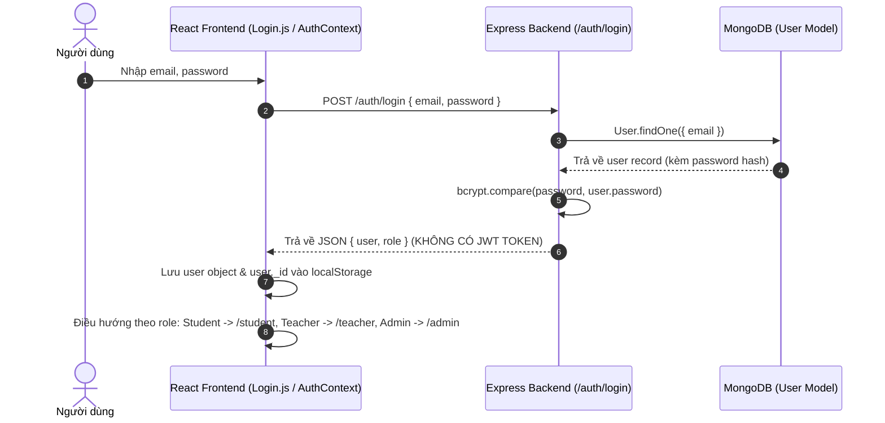
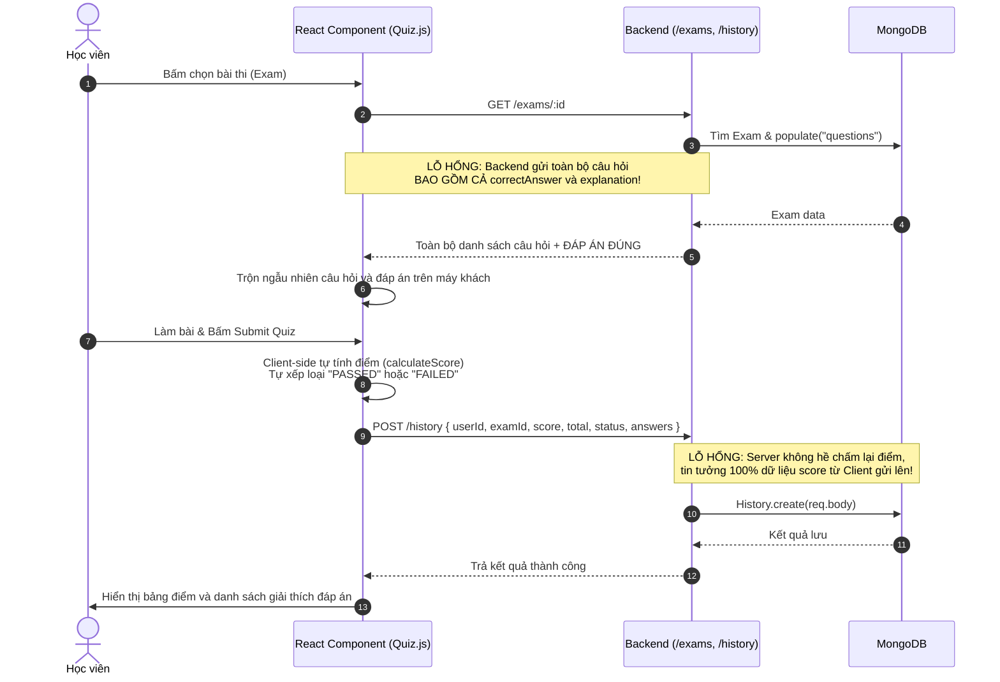

---
title: "Bao Cao Phan Tich Toan Dien & Lo Trinh Nang Cap He Thong EnglishQuiz"
version: "2.0.0"
status: "active"
project: "EnglishQuiz Platform (SDN302)"
category: "architecture-analysis"
tags: ["analysis", "security", "roadmap", "sdn302", "refactoring"]
created: "2026-10-31"
author: "Engineering Team"
---
# BÁO CÁO PHÂN TÍCH TOÀN DIỆN VÀ LỘ TRÌNH NÂNG CẤP DỰ ÁN ENGLISH QUIZ
*(Hệ thống Luyện thi, Kiểm tra Tiếng Anh & Học Flashcard Trực tuyến)*

---

## 1. TỔNG QUAN DỰ ÁN VÀ BÀI TOÁN CẦN GIẢI QUYẾT

### 1.1. Dự án giải quyết vấn đề gì?
Trong quá trình học và ôn luyện chứng chỉ tiếng Anh (TOEIC, IELTS, TOEFL, B1-C2), người học thường gặp phải các rào cản:
- **Thiếu môi trường cọ xát với các dạng bài thi thực tế**: Khó kiểm soát thời gian làm bài, thiếu công cụ tự động đánh giá năng lực theo từng kỹ năng (Ngữ pháp, Từ vựng, Nghe, Đọc).
- **Học trước quên sau**: Người học ghi chép từ vựng rời rạc, không có phương pháp ôn tập ngắt quãng khoa học dẫn đến việc nhanh chóng quên kiến thức sau khi làm đề.
- **Giáo viên và trung tâm thiếu công cụ quản trị đề thi linh hoạt**: Việc soạn đề, phân loại câu hỏi theo ma trận độ khó (Dễ, Trung bình, Khó) và thống kê tỷ lệ đạt/trượt của học viên tốn nhiều thời gian thủ công.

**EnglishQuiz** ra đời nhằm giải quyết bài toán:
1. **Đối với Học viên (Student)**: Cung cấp nền tảng tự luyện tập (Practice), làm bài thi trắc nghiệm bấm giờ (Quiz, Mini-test), ôn tập từ vựng bằng phương pháp lặp lại ngắt quãng (Leitner Spaced Repetition Flashcards), lưu câu hỏi quan trọng (Bookmarks) và biểu đồ phân tích radar đánh giá độ thuần thục theo kỹ năng/chủ đề.
2. **Đối với Giáo viên (Teacher)**: Cung cấp ngân hàng câu hỏi (Question Bank) đa dạng hình thức (Trắc nghiệm, Điền từ, Đúng/Sai, Nối từ), tạo đề thi linh hoạt (sinh tự động theo độ khó hoặc chọn tay thủ công) và theo dõi tiến độ học tập.
3. **Đối với Quản trị viên (Admin)**: Quản lý người dùng, phân quyền truy cập, theo dõi báo cáo biểu đồ ComposedChart (lượt thi, điểm trung bình, xếp hạng học viên).

---

### 1.2. Mức độ giải quyết hiện tại của dự án (Maturity Assessment)
Dự án hiện đang ở mức độ **Proof of Concept (PoC) / Minimum Viable Product (MVP) sơ khai** (thích hợp cho bài tập lớn/đồ án môn học phân tán SDN302), cụ thể:

| Hạng mục | Mức độ hoàn thiện | Đánh giá chi tiết |
| :--- | :--- | :--- |
| **Giao diện người dùng (UI/UX)** | **70%** | Giao diện tương đối đồng bộ với Bootstrap & CSS tùy biến. Đã có đủ các khung hình cho Student, Teacher, Admin. Tuy nhiên còn một số text bị lỗi font (mojibake) và copy-paste thừa từ project khác. |
| **Nghiệp vụ cốt lõi (Core Business)** | **60%** | Đã thực hiện được luồng làm bài, chuyển câu hỏi, xem kết quả, flashcard Leitner, bookmark câu hỏi. Nhưng phần thi bấm giờ chưa có bộ đếm tự động nộp (timer lock). |
| **Xác thực & Bảo mật (Auth & Security)** | **20%** | **Rất yếu**. Chưa có JWT/Session Token, phân quyền chỉ xử lý hời hợt ở giao diện, API hoàn toàn mở; lộ đáp án đề thi ngay trên client-side. |
| **Kiến trúc Backend** | **45%** | Tách được Route & Model của Mongoose. Tuy nhiên dồn toàn bộ logic vào Controller-in-Route, thiếu Middleware xác thực, thiếu Service layer và validation. |
| **Toàn vẹn Dữ liệu (Data Integrity)** | **50%** | Đã có các Schema Mongoose tương đối đầy đủ. Nhưng các chức năng như Thông báo, Góp ý lại chỉ lưu local state (useState), mất sạch khi refresh. |

---

## 2. KIẾN TRÚC HỆ THỐNG HIỆN TẠI (SYSTEM ARCHITECTURE)

Hệ thống được xây dựng theo mô hình **Client - Server (RESTful API Decoupled)**:

```
+-------------------------------------------------------------+
|                     FRONTEND (React SPA)                    |
|  - React 19, React-Bootstrap, React Router v7, Recharts    |
|  - Chạy cổng: http://localhost:3000                        |
+-------------------------------------------------------------+
                              |
                     REST API (HTTP/JSON)
                    (Chưa có Token Header)
                              |
                              v
+-------------------------------------------------------------+
|                     BACKEND (Express.js)                    |
|  - Node.js, Express 5.x, Mongoose 9.x                       |
|  - Chạy cổng: http://localhost:9999                        |
+-------------------------------------------------------------+
                              |
                        Mongoose ODM
                              |
                              v
+-------------------------------------------------------------+
|                   DATABASE (MongoDB Server)                 |
|  - Database: SDN302_project_SP26                            |
|  - Collections: users, questions, exams, history,           |
|                flashcards, bookmarks, topics, skills, certs |
+-------------------------------------------------------------+
```

### 2.1. Cấu trúc mã nguồn Backend (`EnglishQuizBE`)
- **`server.js`**: Điểm khởi tạo ứng dụng Express, kết nối MongoDB, cấu hình CORS và định tuyến các route.
- **`config/db.js`**: Cấu hình kết nối Mongoose đến MongoDB URI (mặc định `mongodb://localhost:27017/SDN302_project_SP26`).
- **`models/`**: Khai báo 9 Schema Mongoose:
  - `User.js`: Thông tin người dùng, mật khẩu hash, role (`Student`, `Teacher`, `Admin`), status (`Active`, `Disabled`), hồ sơ profile.
  - `Question.js`: Ngân hàng câu hỏi hỗ trợ 4 format: `MultipleChoice`, `FillInBlank`, `TrueFalse`, `Matching`, độ khó, giải thích, audioUrl, passage.
  - `Exam.js`: Đề thi gồm tiêu đề, thời lượng, loại (`practice`, `quiz`, `minitest`), cấp độ, liên kết mảng `questions` qua `ObjectId`.
  - `History.js`: Lưu lượt nộp bài, điểm số, trạng thái (PASSED/FAILED) và danh sách đáp án chọn.
  - `Flashcard.js`: Từ vựng ôn tập, chứa thuộc tính `box` (1 đến 5) và `nextReviewDate` phục vụ thuật toán Spaced Repetition.
  - `Bookmark.js`: Đánh dấu câu hỏi hoặc đề thi yêu thích của học viên.
  - `Topic.js`, `Skill.js`, `Certificate.js`: Các danh mục phân loại câu hỏi (Chủ đề, Kỹ năng, Chứng chỉ).
- **`routes/`**: Các tệp xử lý endpoint REST API (`auth.js`, `user.js`, `question.js`, `exam.js`, `history.js`, `flashcard.js`, `bookmark.js`, `topic.js`, `skill.js`, `certificate.js`).

### 2.2. Cấu trúc mã nguồn Frontend (`EnglishQuizFE`)
- **`src/App.js`**: Cấu hình bộ định tuyến `react-router-dom` (v7) và bọc các tầng Context Provider (`AuthProvider`, `ExamProvider`, `ExamHistoryProvider`, `UserProvider`).
- **`src/pages/`**:
  - `Homepage.js`: Trang chủ landing page giới thiệu tính năng, tự chuyển hướng nếu đã đăng nhập.
  - `Login.js`, `Register.js`: Màn hình xác thực tài khoản.
  - `ProtectRoute.js`: Component kiểm tra trạng thái đăng nhập để chặn người dùng chưa đăng nhập.
  - `StudentPage.js`, `TeacherPage.js`, `AdminPage.js`: Màn hình Dashboard phân theo vai trò.
- **`src/components/`**:
  - `User/`: `Practice.js`, `Quiz.js`, `Flashcards.js`, `Bookmarks.js`, `History.js`, `Profile.js`, `UserDashboard.js`, `UserFeedback.js`.
  - `Teacher/`: `TeacherDashboard.js`.
  - `Admin/`: `Admindashboard.js`, `ExamManagement.js`, `QuestionBank.js`, `Reports.js`, `SystemNotice.js`, `TopicManagement.js`, `Usermanagement.js`.
  - `common/` và gốc `components/`: `Header.js`, `Sidebar.js`, `Footer.js` (đang có sự trùng lặp file giữa 2 thư mục này).
- **`src/context/`**:
  - `AuthContext.js`: Lưu trạng thái `user`, hàm `login`, `logout` vào `localStorage`.
  - `ExamContext.js`, `ExamHistoryContext.js`, `UserContext.js`: Quản lý state tập trung (tuy nhiên hầu hết các component lại đang tự gọi `axios` riêng).

---

## 3. CHI TIẾT CÁC MODULE VÀ LUỒNG HOẠT ĐỘNG (WORKFLOWS)

### 3.1. Luồng Xác thực & Phân quyền (Authentication & Authorization Flow)

- **Hạn chế**: Khi đã đăng nhập, người dùng chỉ cần gõ tay đường dẫn `/admin` trên URL trình duyệt là có thể mở giao diện quản trị do `ProtectRoute.js` chỉ kiểm tra `isAuthenticated` mà không kiểm tra Role.

---

### 3.2. Luồng Luyện thi & Chấm điểm (Quiz / Practice Workflow)


---

### 3.3. Luồng Ôn tập Từ vựng Leitner Spaced Repetition (Flashcard Workflow)
1. Học viên vào tab **Flashcards**: Hệ thống gọi `GET /flashcards/user/:userId` lấy danh sách thẻ ghi nhớ.
2. Thẻ hiển thị mặt trước (Từ vựng, phát âm qua Web Speech API `speechSynthesis`).
3. Học viên bấm lật thẻ (Flip) để xem định nghĩa, ví dụ câu.
4. Học viên tự đánh giá:
   - **Nhớ đúng (Correct)**: Bấm `Check` -> Gửi `POST /flashcards/:id/review` với `{ isCorrect: true }`.
     - Backend tăng `box = min(box + 1, 5)`.
     - Tính ngày ôn tiếp theo: Hộp 1: +1 ngày, Hộp 2: +3 ngày, Hộp 3: +7 ngày, Hộp 4: +14 ngày, Hộp 5: +30 ngày.
   - **Nhớ sai (Incorrect)**: Bấm `Cross` -> Gửi `{ isCorrect: false }`.
     - Backend reset ngay lập tức về `box = 1`, đặt `nextReviewDate = hôm nay + 1 ngày`.

---

### 3.4. Luồng Giáo viên Quản lý Ngân hàng Câu hỏi & Soạn Đề thi
1. **Ngân hàng câu hỏi (`QuestionBank.js`)**:
   - Giáo viên thêm câu hỏi mới: Chọn kỹ năng (Listening/Grammar...), chủ đề (Family/Business...), chứng chỉ mục tiêu (TOEIC/IELTS), mức độ (Easy/Medium/Hard) và dạng câu hỏi (MultipleChoice, FillInBlank, Matching).
   - Dữ liệu gửi lên `POST /questions` lưu trực tiếp vào cơ sở dữ liệu.
2. **Quản lý đề thi (`ExamManagement.js`)**:
   - Giáo viên cấu hình: Tên đề thi, thời gian làm bài (phút), thể loại (`quiz`, `practice`, `minitest`).
   - Có 2 chế độ chọn câu hỏi:
     - **Tự động (Auto)**: Chọn số lượng câu Easy, Medium, Hard -> Client lọc ngẫu nhiên từ ngân hàng câu hỏi đã load.
     - **Thủ công (Manual)**: Tự tick chọn từng câu hỏi theo bộ lọc.
   - Gửi mảng ID câu hỏi lên `POST /exams` để tạo bài kiểm tra.

---

### 3.5. Luồng Quản trị & Báo cáo Thống kê (Admin & Reports)
1. **Quản trị người dùng (`Usermanagement.js`)**: Xem danh sách toàn bộ user (`GET /users`), bấm vô hiệu hóa tài khoản (`DELETE /users/:id` -> đổi status thành `Disabled`) hoặc mở lại (`PUT /users/:id` với `{ status: "Active" }`).
2. **Báo cáo phân tích (`Reports.js`)**: Gọi song song 4 API (`/users`, `/questions`, `/exams/stats`, `/history`), tính toán số lượt thi, điểm trung bình toàn hệ thống, vẽ biểu đồ dạng thanh kết hợp đường kẻ (ComposedChart) thể hiện xu hướng làm bài.

---

## 4. TỔNG HỢP CÁC LỖ HỔNG VÀ SAI SÓT ĐANG TỒN TẠI (CRITICAL DEFICIENCIES)

### 4.1. Lỗ hổng Bảo mật Nghiêm trọng (Security Vulnerabilities)
1. **Lộ toàn bộ đáp án đề thi cho Client (Cheat Vulnerability)**:
   - Khi làm bài thi (`GET /exams/:id`), API backend trả về cả trường `correctAnswer` và `explanation`. Bất kỳ học sinh nào mở tab Network trong DevTools (F12) đều nhìn thấy đáp án chính xác 100%.
2. **Gian lận điểm số tuyệt đối (Score Manipulation)**:
   - Logic tính điểm nằm hoàn toàn ở hàm `calculateScore` trên Frontend `Quiz.js`. Khi nộp bài, Client tự đóng gói `{ score: 10, total: 10, status: "PASSED" }` gửi lên `POST /history`. Kẻ xấu có thể dùng Postman hoặc Console để ghi điểm số tùy ý mà Server không hề kiểm tra lại.
3. **Hoàn toàn không có cơ chế JWT Authentication / Authorization**:
   - Mọi API routes đều công khai (public). Bất kỳ ai cũng có thể gửi lệnh `DELETE /users/:id`, `POST /exams`, `DELETE /history/:id` mà không cần token xác thực quyền Admin hay Teacher.
4. **Fallback so sánh mật khẩu dạng chuỗi trần (Plaintext Fallback)**:
   - Trong `routes/auth.js` dòng 62: `if (isMatch || password === user.password)` -> Cho phép đăng nhập bằng cả mật khẩu chưa mã hóa nếu trong DB lưu dạng plaintext, vi phạm nghiêm trọng tiêu chuẩn an toàn thông tin.
   - Khi đăng nhập thành công, toàn bộ object `user` (bao gồm chuỗi hash password) được trả về client và lưu thẳng vào `localStorage`.
5. **Hở sườn phân quyền Frontend (Broken Access Control)**:
   - `ProtectRoute.js` chỉ kiểm tra `isAuthenticated` (có user trong `localStorage` hay không) mà không phân biệt Role. Học viên chỉ cần gõ `/admin` trên trình duyệt là xem được trang Admin.

---

### 4.2. Lỗi Kiến trúc, Thiết kế Code & Dư thừa (Architecture & Code Smells)
1. **Bất nhất giữa Context API và Component (Dead / Disconnected Code)**:
   - Trong `ExamContext.js` có các hàm gọi `http://localhost:9999/exams/:id/questions` và `/submit`. Nhưng trên thực tế Backend **không hề có 2 endpoint này**!
   - Các component như `Quiz.js`, `Practice.js`, `ExamManagement.js` không dùng `ExamContext` mà tự import `axios` rồi fetch độc lập, dẫn đến code bị lặp lại và phân mảnh state.
2. **Hardcoded Địa chỉ API & Port**:
   - URL `http://localhost:9999` bị viết cứng (hardcoded) ở hàng chục file Frontend thay vì dùng biến môi trường `process.env.REACT_APP_API_URL`.
   - Cổng chạy Backend bị gán cứng `app.listen(9999)` thay vì `process.env.PORT || 9999`.
3. **Trùng lặp tập tin thành phần giao diện (Component Redundancy)**:
   - Tồn tại đồng thời `src/components/Header.js`, `Sidebar.js`, `Footer.js` và `src/components/common/Header.js`, `Sidebar.js`, `Footer.js` với mã nguồn gần giống nhau, gây nhầm lẫn khi bảo trì.
4. **Thiếu Tầng Kiến trúc Backend (No Layered Architecture)**:
   - Toàn bộ nghiệp vụ truy vấn DB, lọc dữ liệu, tính toán thống kê được viết trực tiếp bên trong callback của Express Route. Không có Controller, không có Service Layer, không có Validation Schema (như Joi / Zod).

---

### 4.3. Dữ liệu Mồ côi và Các Tính năng Chưa Hoàn Thiện (Unfinished Features)
1. **Chức năng "ảo" chỉ lưu trên `useState`**:
   - `SystemNotice.js` (Thông báo hệ thống của Admin) và `UserFeedback.js` (Học viên góp ý) hoàn toàn không có Model và API Backend tương ứng. Mọi thao tác thêm/xóa chỉ lưu tạm trong RAM trình duyệt, F5 là biến mất.
2. **Nội dung "rác" từ đồ án cũ (Copy-Paste Leftovers)**:
   - Trong `EnglishQuizFE/package.json` tên dự án vẫn là `"studentservicefe"`.
   - Trong `UserFeedback.js` xuất hiện các dòng nội dung tĩnh như: *"Dịch vụ rất tốt, cảm ơn nhà trường!"*, *"Mong có thêm dịch vụ hỗ trợ đăng ký câu lạc bộ."* -> Hoàn toàn không liên quan đến ứng dụng trắc nghiệm tiếng Anh.
3. **Lỗi hiển thị Font chữ tiếng Việt (Mojibake / Encoding Bugs)**:
   - Nhiều file nguồn chứa chuỗi hiển thị bị vỡ encoding do lưu file sai định dạng (ví dụ: `dY"? CHANGE PASSWORD`, `dY"s Lấy danh sách đề thi`, `ThA'ng bAo h th`ng`).
4. **Thiếu cơ chế quản lý File/Media thực tế**:
   - Trường `audioUrl` cho câu hỏi Listening và `image` cho Topics chỉ lưu dạng chuỗi text thuần, chưa có API upload file (Multer) hoặc kết nối lưu trữ cloud (Cloudinary / S3).
5. **Chưa có đồng hồ đếm ngược tự động nộp bài (Exam Timer Lock)**:
   - Dù đề thi có cấu hình `duration` (ví dụ 30 phút), giao diện làm bài `Quiz.js` không có bộ đếm thời gian thực đếm ngược và không tự động khóa/nộp bài khi hết giờ.

---

## 5. PHƯƠNG ÁN TRIỂN KHAI VÀ TÁI CẤU TRÚC HOÀN CHỈNH (IN-PLACE MODERNIZATION ROADMAP)

> **NGUYÊN TẮC CỐT LÕI**: Giữ nguyên nền tảng React 19 + Express + MongoDB hiện có. Không cần xóa code làm lại từ đầu. Thay vào đó, áp dụng chiến lược nâng cấp từng bước (Refactoring in-place), vá lỗi kiến trúc và gia cố bảo mật.

---

### GIAI ĐOẠN 1: GIA CỐ BẢO MẬT & CHUẨN HÓA API BACKEND (Thời gian ước tính: 2 - 3 ngày)

#### 1.1. Tích hợp JWT Authentication & Phân quyền chuẩn
- Cài đặt thư viện: `npm install jsonwebtoken dotenv` trong `EnglishQuizBE`.
- Tạo file `.env` cho Backend:
  ```env
  PORT=9999
  MONGO_URI=mongodb://localhost:27017/SDN302_project_SP26
  JWT_SECRET=super_secret_jwt_key_sdn302_2026
  JWT_EXPIRES_IN=7d
  ```
- Viết middleware kiểm tra Token và Quyền hạn (`EnglishQuizBE/middleware/auth.js`):
  ```javascript
  const jwt = require("jsonwebtoken");

  const verifyToken = (req, res, next) => {
    const authHeader = req.headers.authorization;
    if (!authHeader || !authHeader.startsWith("Bearer ")) {
      return res.status(401).json({ message: "Không có quyền truy cập. Token thiếu hoặc không hợp lệ." });
    }
    const token = authHeader.split(" ")[1];
    try {
      const decoded = jwt.verify(token, process.env.JWT_SECRET);
      req.user = decoded; // { id, role, email }
      next();
    } catch (err) {
      return res.status(403).json({ message: "Token đã hết hạn hoặc không hợp lệ." });
    }
  };

  const requireRoles = (...roles) => {
    return (req, res, next) => {
      if (!req.user || !roles.includes(req.user.role)) {
        return res.status(403).json({ message: "Bạn không có quyền thực hiện hành động này." });
      }
      next();
    };
  };

  module.exports = { verifyToken, requireRoles };
  ```
- Sửa `routes/auth.js`: Ký JWT token khi login thành công, loại bỏ so sánh mật khẩu thô và loại bỏ trường `password` trước khi trả dữ liệu về:
  ```javascript
  const token = jwt.sign(
    { id: user._id, role: user.role, email: user.email },
    process.env.JWT_SECRET,
    { expiresIn: process.env.JWT_EXPIRES_IN || "7d" }
  );
  res.json({ token, user: { _id: user._id, name: user.name, email: user.email, role: user.role } });
  ```

#### 1.2. Chuyển toàn bộ Logic Chấm điểm về Server (Fix Cheat)
- **Tạo endpoint thi an toàn**:
  - `GET /exams/:id/take`: Khi học sinh lấy đề để làm, server dùng Mongoose projection loại bỏ hoàn toàn các trường nhạy cảm:
    ```javascript
    const exam = await Exam.findById(req.params.id)
      .populate("questions", "-correctAnswer -explanation");
    ```
- **Tạo endpoint nộp bài**:
  - `POST /exams/:id/submit`: Client chỉ gửi danh sách đáp án học sinh đã chọn:
    ```json
    {
      "answers": {
        "questionId_1": "1",
        "questionId_2": "true",
        "questionId_3": "{\"0\": 1, \"1\": 0}"
      }
    }
    ```
  - Server lấy danh sách `Question` tương ứng từ DB, tự so sánh và tính `score`, xếp loại `PASSED`/`FAILED`, tạo bản ghi vào `History` và chỉ trả kết quả + giải thích sau khi đã chấm xong.

---

### GIAI ĐOẠN 2: CHUẨN HÓA VÀ DỌN DẸP FRONTEND (Thời gian ước tính: 2 - 3 ngày)

#### 2.1. Cấu hình Biến môi trường & Axios Interceptor
- Tạo file `.env` trong `EnglishQuizFE`:
  ```env
  REACT_APP_API_URL=http://localhost:9999
  ```
- Tạo file trung tâm quản lý HTTP client `src/api/axiosClient.js`:
  ```javascript
  import axios from "axios";

  const axiosClient = axios.create({
    baseURL: process.env.REACT_APP_API_URL || "http://localhost:9999",
    headers: { "Content-Type": "application/json" }
  });

  axiosClient.interceptors.request.use((config) => {
    const token = localStorage.getItem("token");
    if (token) {
      config.headers.Authorization = `Bearer ${token}`;
    }
    return config;
  });

  axiosClient.interceptors.response.use(
    (response) => response,
    (error) => {
      if (error.response?.status === 401) {
        localStorage.clear();
        window.location.href = "/login";
      }
      return Promise.reject(error);
    }
  );

  export default axiosClient;
  ```

#### 2.2. Vá lỗi Bảo vệ Route dựa trên Role (`ProtectRoute.js`)
Cập nhật `ProtectRoute` để nhận mảng `allowedRoles`:
```javascript
import { Navigate, Outlet } from "react-router-dom";
import { useContext } from "react";
import { AuthContext } from "../context/AuthContext";

function ProtectRoute({ allowedRoles }) {
  const { user, isAuthenticated, loading } = useContext(AuthContext);

  if (loading) return <div>Đang tải...</div>;
  if (!isAuthenticated) return <Navigate to="/login" replace />;

  if (allowedRoles && !allowedRoles.includes(user?.role?.toUpperCase())) {
    // Không đúng quyền -> Chuyển về trang phù hợp hoặc trang chủ
    return <Navigate to="/" replace />;
  }

  return <Outlet />;
}

export default ProtectRoute;
```
Trong `App.js`:
```jsx
<Route element={<ProtectRoute allowedRoles={["STUDENT"]} />}>
  <Route path="/student" element={<StudentPage />} />
</Route>
<Route element={<ProtectRoute allowedRoles={["TEACHER"]} />}>
  <Route path="/teacher" element={<TeacherPage />} />
</Route>
<Route element={<ProtectRoute allowedRoles={["ADMIN"]} />}>
  <Route path="/admin" element={<AdminPage />} />
</Route>
```

#### 2.3. Dọn dẹp Code trùng lặp & Sửa lỗi Font chữ
- Xóa bỏ thư mục thừa `src/components/common` (hoặc chuyển hẳn các file dùng chung vào đây và xóa các file gốc ở `src/components/Header.js`, `Sidebar.js`, `Footer.js`).
- Chuyển toàn bộ các file mã nguồn sang định dạng UTF-8 để hiển thị đúng dấu tiếng Việt.
- Đổi tên ứng dụng trong `EnglishQuizFE/package.json` thành `"englishquiz-fe"`.

---

### GIAI ĐOẠN 3: HOÀN THIỆN TÍNH NĂNG & DỮ LIỆU CÒN THIẾU (Thời gian ước tính: 2 ngày)

#### 3.1. Hiện thực hóa Feedback & SystemNotice trên Database
- Tạo 2 Model mới ở Backend:
  - `models/Feedback.js`: `userId`, `content`, `rating`, `createdAt`.
  - `models/Notice.js`: `title`, `content`, `createdBy`, `priority`, `createdAt`.
- Tạo các route tương ứng:
  - `routes/feedback.js`: Học sinh gửi phản hồi, Admin xem danh sách phản hồi.
  - `routes/notice.js`: Admin đăng thông báo, toàn bộ User xem thông báo hệ thống.
- Kết nối `UserFeedback.js` và `SystemNotice.js` trên Frontend vào 2 route này, thay thế hoàn toàn biến `useState` tĩnh.

#### 3.2. Bổ sung Bộ đếm Thời gian thực (Exam Timer)
- Trong `Quiz.js`, tích hợp `useEffect` đếm lùi thời gian dựa trên `selectedExam.duration * 60`:
  - Hiển thị thanh đếm thời gian nổi bật (Visual Timer Badge).
  - Khi `timeLeft === 0`, tự động gọi `handleSubmit()` để cưỡng chế nộp bài, ngăn chặn học viên làm bài quá thời gian quy định.

#### 3.3. Hỗ trợ Audio & Image Upload
- Cài đặt `multer` tại Backend.
- Viết API `POST /upload/audio` và `POST /upload/image` lưu file vào thư mục tĩnh `uploads/` (serve qua `express.static("uploads")`).
- Giáo viên có thể bấm nút "Upload File Nghe" khi soạn câu hỏi Listening thay vì phải tự copy link online.

---

### GIAI ĐOẠN 4: TỐI ƯU HÓA HIỆU NĂNG & TRIỂN KHAI (DEVOPS) (Thời gian ước tính: 1 - 2 ngày)

#### 4.1. Đánh chỉ mục (Indexing) cho MongoDB
Thêm index cho các trường truy vấn thường xuyên:
```javascript
// models/History.js
HistorySchema.index({ userId: 1, createdAt: -1 });
HistorySchema.index({ examId: 1 });

// models/Question.js
QuestionSchema.index({ topic: 1, skill: 1, level: 1 });

// models/Flashcard.js
FlashcardSchema.index({ userId: 1, nextReviewDate: 1 });
```

#### 4.2. Đóng gói Container với Docker Compose
Tạo tệp `docker-compose.yml` ở thư mục gốc để triển khai 1-click:
```yaml
version: '3.8'

services:
  mongodb:
    image: mongo:6.0
    container_name: englishquiz-db
    ports:
      - "27017:27017"
    volumes:
      - mongo_data:/data/db

  backend:
    build: ./EnglishQuizBE
    container_name: englishquiz-backend
    ports:
      - "9999:9999"
    environment:
      - PORT=9999
      - MONGO_URI=mongodb://mongodb:27017/SDN302_project_SP26
      - JWT_SECRET=prod_secret_sdn302
    depends_on:
      - mongodb

  frontend:
    build: ./EnglishQuizFE
    container_name: englishquiz-frontend
    ports:
      - "3000:80"
    depends_on:
      - backend

volumes:
  mongo_data:
```

---

## 6. BẢNG SO SÁNH: HIỆN TRẠNG VS HỆ THỐNG SAU KHI NÂNG CẤP

| Tiêu chí so sánh | Hiện trạng của dự án | Sau khi nâng cấp theo lộ trình |
| :--- | :--- | :--- |
| **Xác thực (Auth)** | Lưu User vào LocalStorage, không có Token. | Sử dụng **JWT (Access Token)** trong Authorization Header. |
| **Bảo vệ Route (RBAC)** | Chỉ kiểm tra `isAuthenticated`, vào được mọi URL. | Phân quyền nghiêm ngặt theo vai trò (`Student`, `Teacher`, `Admin`). |
| **Chấm điểm thi** | Frontend tự tính điểm, dễ gian lận và hack điểm qua F12. | **Server-side Grading**: Server tự chấm, giấu đáp án khi làm bài. |
| **Bảo mật đề thi** | Client nhận toàn bộ `correctAnswer` và `explanation`. | Đáp án chỉ được trả về sau khi học sinh đã nộp bài. |
| **Quản lý thời gian** | Không có đếm ngược, làm bài vô hạn thời gian. | **Đồng hồ đếm ngược (Countdown Timer)**, tự động nộp khi hết giờ. |
| **Góp ý & Thông báo** | Lưu biến tạm `useState` (F5 là mất). | Lưu trữ bền vững trong MongoDB (Collection `feedbacks`, `notices`). |
| **Quản lý Gọi API** | `axios.get("http://localhost:9999/...")` rải rác khắp nơi. | **Axios Interceptor** tập trung, cấu hình qua biến môi trường `.env`. |
| **Cấu trúc mã nguồn** | Trùng lặp file giao diện, lỗi font tiếng Việt. | Cấu trúc chuẩn hóa, mã nguồn sạch sẽ, không code chết. |

---

## 7. PHÂN BỔ NHIỆM VỤ THỰC THI CHO 3 DEVELOPERS

Để hiện thực hóa lộ trình trên một cách song song và hiệu quả nhất, nhóm 3 thành viên được phân chia theo 3 Role cụ thể:

| Thành viên | Trách nhiệm chính (Full-stack Vertical Slice) | Các tính năng phụ trách trực tiếp |
| :--- | :--- | :--- |
| **DEV 1 (Người thứ nhất)** | **ROLE STUDENT (Học viên & Trải nghiệm Luyện thi)** | - Nâng cấp Phòng thi trực tuyến (`Quiz.js`): Bổ sung Countdown Timer, Question Palette, tự nộp khi hết giờ.<br/>- Sửa lỗi nộp điểm: Kết nối với API nộp bài Server-side grading.<br/>- Màn hình xem lại kết quả (`QuizResult.js` / Review) có giải thích chi tiết.<br/>- Nâng cấp Flashcards: Thuật toán 5 hộp Leitner, hiệu ứng Flip 3D, Web Speech phát âm TTS.<br/>- Xây dựng **Sổ tay lỗi sai (Mistake Notebook)** & Chế độ Luyện tập Tức thì (Practice Mode).<br/>- Tích hợp **AI Tutor cho Học viên** (Giải thích câu sai, sinh ví dụ Flashcard). |
| **DEV 2 (Người thứ hai)** | **ROLE TEACHER (Giáo viên & Quản lý Đề thi)** | - Hoàn thiện Ngân hàng câu hỏi (`QuestionBank.js`): Trắc nghiệm, Điền từ, Đúng/Sai, Nối cặp, Bài đọc, Bài nghe.<br/>- Soạn đề thi theo **Ma trận độ khó (Matrix Composer)**: Tự động bốc câu hỏi theo tỷ lệ % Easy, Medium, Hard.<br/>- Xây dựng **Lõi chấm điểm an toàn (Evaluation Core)** phía Server (`GET /take` ẩn đáp án, `POST /submit` server tự chấm).<br/>- Tích hợp **AI Exam Generator cho Giáo viên** (Nhập văn bản/chủ đề -> Sinh đề trắc nghiệm chuẩn JSON). |
| **DEV 3 (Người thứ ba)** | **ROLE ADMIN & CORE INFRASTRUCTURE (Quản trị & Nền tảng)** | - Dựng khung bảo mật chung: **JWT Authentication**, phân quyền **RBAC Middleware**, sửa lỗ hổng vào trang Admin.<br/>- Xây dựng `axiosClient` trung tâm có interceptor tự gắn Token và xử lý 401.<br/>- Dọn dẹp code thừa: Xóa `components/common` trùng lặp, gỡ bỏ `lucide-react`, sửa lỗi font tiếng Việt.<br/>- Hoàn thiện Quản trị Người dùng (`Usermanagement.js`) & Quản trị Danh mục (Topics, Skills, Certificates).<br/>- Chuyển `SystemNotice` và `UserFeedback` sang lưu trữ MongoDB thực tế.<br/>- Hệ thống Báo cáo Thống kê (`Reports.js`) với biểu đồ Recharts. |

---

## 8. KẾT LUẬN VÀ KHUYẾN NGHỊ

Dự án **EnglishQuiz** có **ý tưởng sản phẩm rất tốt** và **bộ khung dữ liệu phong phú** (đã xây dựng sẵn cấu trúc câu hỏi đa dạng, thuật toán Spaced Repetition Leitner, tích hợp biểu đồ trực quan hóa dữ liệu và phát âm từ vựng).

Người phát triển **HOÀN TOÀN KHÔNG CẦN VÀ KHÔNG NÊN ĐẬP ĐI XÂY LẠI TỪ ĐẦU**, bởi vì việc này gây lãng phí toàn bộ giao diện đã làm và schema cơ sở dữ liệu đã thiết kế. Thay vào đó, hãy thực hiện theo đúng **Lộ trình nâng cấp 4 giai đoạn** và phân công 3 người rõ ràng như trên.


