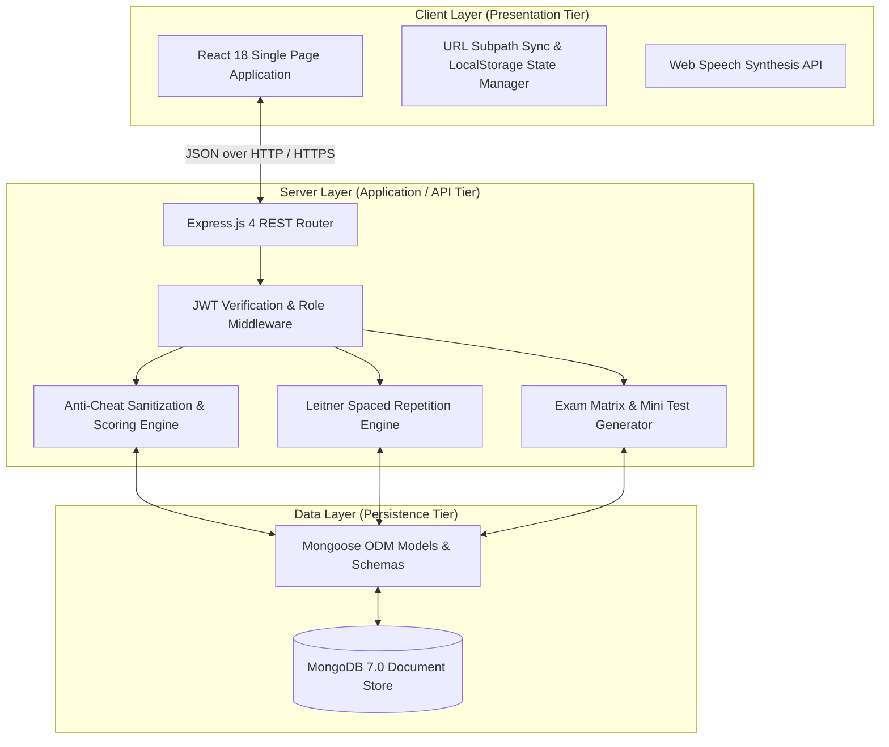
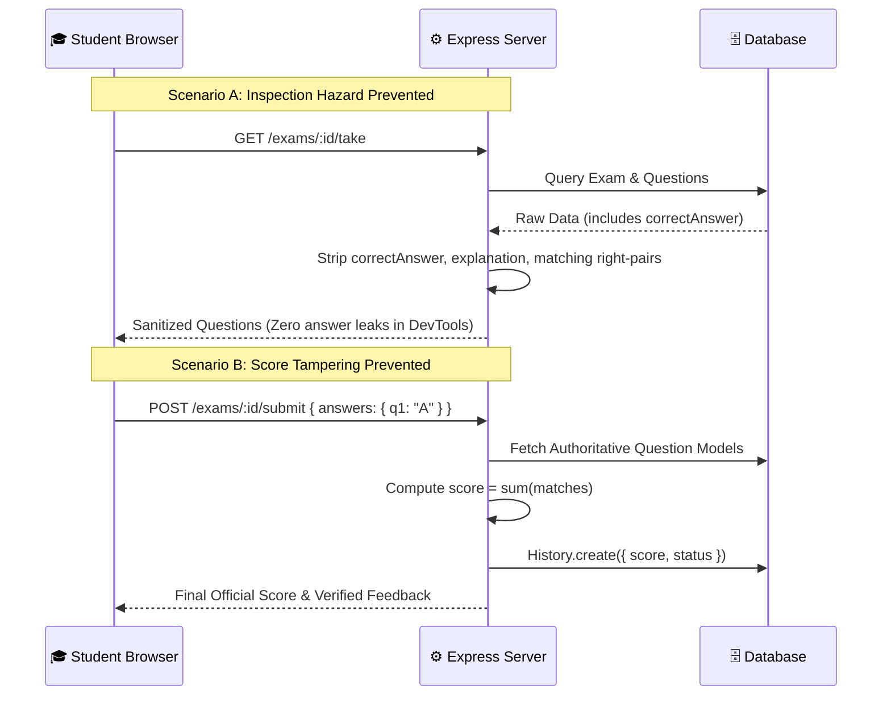
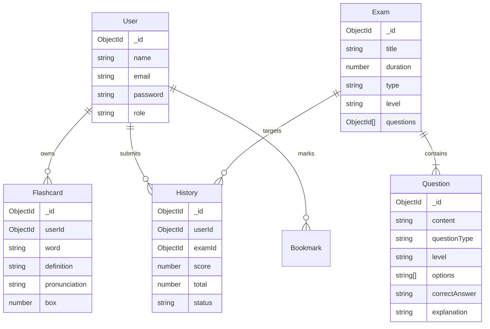

# System Architecture & Technical Specifications
## EnglishQuiz Platform — SDN302 FA26

---

## 1. Architectural Overview

The **EnglishQuiz Platform** follows a modern **3-Tier Layered Architecture** adhering to clean separation of concerns, high cohesion, and loose coupling.

---

## 2. Component Design & Responsibility Matrix

### 2.1 Frontend Architecture (`EnglishQuizFE`)
- **Port:** 3000
- **Routing:** React Router DOM v6 with dynamic nested subpath sync (`/student/:tab`, `/teacher/:tab`, `/admin/:tab`).
- **Core Modules:**
  1. `ExamRoom.jsx`: Kombai-designed TOEIC Reading Mini Test layout, countdown timer, question palette, and keyboard navigation.
  2. `Flashcard3D.jsx`: 3D perspective flip card (380x240px, 24px border radius, 0.6s cubic-bezier timing), IPA font integration, and pronunciation synthesis.
  3. `QuizReview.jsx`: Post-exam score breakdown with pass/fail badges, time spent, and question-by-question explanations.
  4. `ExamComposer.jsx`: Automated matrix exam generator for teachers/admins.
  5. `Header.jsx`: Top navigation, notice bell with badge count, and active exam lockdown alert.

### 2.2 Backend Architecture (`EnglishQuizBE`)
- **Port:** 9999
- **Framework:** Express.js with JSON body parsing and CORS configuration.
- **Core Services:**
  1. **Anti-Cheat Exam Engine (`routes/exam.js`):**
     - `GET /exams/:id/take`: Strips `correctAnswer` and `explanation` from questions before sending to the client.
     - `POST /exams/:id/submit`: Evaluates examinee answers against server database models, calculates score, and records a permanent `History` entry.
  2. **Automated Exam Compilation (`routes/exam.js`):**
     - `POST /exams/matrix/generate`: Compiles balanced exams across CEFR difficulty levels (Easy, Medium, Hard).
     - `POST /exams/minitest/generate`: Generates 5–15 question Quick Mini Tests with automated notification broadcast to Students.
  3. **Spaced Repetition System (`routes/flashcard.js`):**
     - `POST /flashcards/:id/review`: Implements the Leitner algorithm (Box 1–5 progression, demotion on error to Box 1).

---

## 3. Security & Anti-Cheat Protocols

---

## 4. Database Schema Specifications

---

## 5. Network Routing & F5 State Preservation

To eliminate state loss upon page reload:
- URL Subpaths are maintained in sync with the current active tab (`/student/quiz`, `/student/minitest`, `/student/flashcards`, `/teacher/exams`, `/admin/users`).
- On F5 refresh, `getInitialTab()` reads `location.pathname` and initializes the tab component immediately without falling back to Dashboard.

